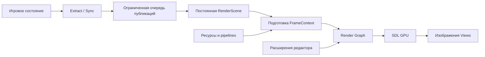

**1. Назначение и объём.** Рендерер Continuum отображает сцену через несколько камер, поддерживает пользовательские материалы и проходы, управляет ресурсами и позволяет объяснить стоимость и результат каждого кадра.

В обязательный объём входят:

- PBR, HDR, экспозиция и tone mapping;
- Clustered Forward, источники света и карты теней;
- IBL, импорт запечённого освещения и опциональное SSGI;
- непрозрачные, masked и прозрачные материалы;
- сортируемая прозрачность и Weighted Blended OIT;
- несколько Views, render targets и средства отображения порталов;
- GPU culling, выбор LOD, instancing и indirect draw;
- compute skinning и повторное использование деформированной геометрии;
- CPU- и GPU-частицы;
- TAA, пространственное сглаживание и управляемый масштаб изображения;
- асинхронная подготовка ресурсов и pipelines;
- публичный Render Graph;
- инструменты редактора и встроенная диагностика.

Первичные платформы — **macOS arm64 и Windows x64**. Исполнение GPU-команд реализуется через SDL GPU. Публичные понятия сцены, материалов, Views и ресурсов принадлежат движку.

Собственный baker, visual material graph и собственные реализации Vulkan/Metal/D3D12 не входят в обязательный объём.

Цель производительности самостоятельной игры — **60 FPS при внутреннем разрешении 2560×1440** на выбранной контрольной конфигурации. Для редактора используется отдельный профиль с зафиксированным набором активных Views.

Конкретные компьютеры и контрольные нагрузки ещё предстоит выбрать. До этого 60 FPS являются целью проектирования, а не доказанной характеристикой.

**2. Основные понятия.** Система различает состояние игры, представление сцены для рендера и данные конкретного изображения.

| Понятие | Назначение |
|---|---|
| `ScenePublication` | Согласованный неизменяемый пакет изменений от приложения |
| `RenderScene` | Постоянное CPU-представление объектов, света, камер и эффектов |
| `FrameContext` | Данные и ресурсы одного подготавливаемого или исполняемого GPU-кадра |
| `View` | Представление сцены через определённую камеру и настройки |
| `MeshResource` | Геометрия, каналы вершин, submeshes и доступные LOD |
| `ShaderInterface` | Требования шейдера к данным, ресурсам и проходам |
| `MaterialTemplate` | Программа материала, параметры, значения по умолчанию и допустимые варианты |
| `MaterialInstance` | Конкретные значения параметров и ссылки на ресурсы |
| `Pipeline` | Подготовленное сочетание программ и фиксированного графического состояния |
| `RenderGraph` | Объявленные проходы, версии ресурсов и зависимости между ними |

Идентификаторы ресурсов и объектов различаются по назначению:

- постоянный `AssetID` используется в сохранённых данных;
- runtime handle обозначает живой объект внутри конкретного владельца;
- поколение handle отличает новый объект от удалённого объекта с переиспользованным индексом;
- версия обозначает содержимое ресурса;
- идентификатор мира отличает редакторскую сцену, Play и другие независимые сцены.

Адреса C++-объектов и SDL handles не сохраняются в сценах.

**3. Единицы и соглашения.** Новый render API использует метры для расстояний, секунды для времени и радианы для углов. Интерфейс редактора может показывать градусы, выполняя преобразование на своей границе.

Сохраняются подтверждённые соглашения математического модуля Continuum:

- вправо — `+X`;
- вверх — `+Y`;
- вперёд — `+Z`;
- проекция использует диапазон глубины `[0, 1]`.

Каналы геометрии явно указывают пространство данных. Позиции меша обычно заданы в локальном пространстве; матрица объекта переводит их в мировое.

Освещение вычисляется в линейном цветовом пространстве. Цветовые текстуры имеют обозначенное encoding; normal maps, маски и другие числовые данные обрабатываются как линейные данные.

У параметров света определяются единицы, например lux для направленного света и lumens для светового потока point/spot lights. Преобразование в используемые шейдером величины выполняет система освещения. Формат запечённых данных содержит соответствующие соглашения.

**4. Границы ответственности.** Следующая таблица описывает логические части системы. Каждая строка не обязательно становится отдельным классом или библиотекой.

| Часть | Ответственность |
|---|---|
| Интеграция приложения | Извлекает изменения из игрового состояния |
| Публикация и синхронизация | Передаёт согласованные изменения и управляет ожиданием |
| `RenderScene` | Хранит постоянное представление сцены |
| Планировщик кадров | Выбирает активные Views и управляет двумя кадровыми контекстами |
| Подготовка ресурсов | Импортирует и подготавливает данные для платформы |
| Хранилище ресурсов | Управляет версиями, загрузкой, доступным качеством и временем жизни |
| Система материалов и шейдеров | Описывает интерфейсы, параметры и варианты |
| Кэш pipelines | Объединяет запросы и хранит состояния подготовки |
| Подготовка рисования | Формирует группы, видимость, LOD и деформацию |
| Система освещения | Подготавливает свет, тени и непрямое освещение |
| Render Graph | Определяет порядок работы и использование ресурсов |
| SDL-исполнение | Создаёт GPU-объекты и записывает команды |
| Диагностика | Показывает состояния, причины решений и измерения |
| Расширения редактора | Добавляют grid, gizmos, picking и debug views |

Игровой renderer не зависит от редактора или конкретного ECS. Связь ECS со сценой рендера выполняется отдельным адаптером.

Render Graph и система материалов используют типы движка. SDL остаётся внутри реализации исполнения и платформенных адаптеров.

**5. Потоки и владение.** Главный поток владеет окном, обработкой событий, интерфейсом, постоянным состоянием renderer и отправкой GPU-команд. Симуляция работает отдельно.

Рабочие задачи выполняют чтение файлов, импорт, декомпрессию, генерацию каналов, компиляцию шейдеров и другие независимые вычисления.

Рабочие задачи получают принадлежащие им данные или стабильные ссылки на владельцев. Они не сохраняют временные указатели на компоненты ECS и не изменяют опубликованные пакеты.

Результат задачи содержит версию исходного запроса. Устаревший результат не заменяет более свежий ресурс.

В базовой реализации главный поток **последовательно подготавливает и отправляет кадры**. Параллельная подготовка кадров, зависящих от ещё не отправленных предшественников, не требуется.

SDL command buffer используется и отправляется на потоке, где был получен. Операции swapchain выполняются на потоке окна. [Договор SDL command buffer](https://wiki.libsdl.org/SDL3/SDL_GPUCommandBuffer)

**6. Публикация изменений сцены.** Приложение изменяет игровое состояние, затем на границе `Extract/Sync` формирует одну согласованную публикацию.

Публикация содержит:

- идентичность мира и последовательность публикации;
- время и номер шага симуляции;
- упорядоченные операции жизненного цикла;
- изменённые свойства объектов;
- согласованные массивы трансформаций, поз и других данных;
- необходимые ссылки на версии ресурсов;
- обязательные события эффектов.

Публикация владеет переданными данными либо удерживает их владельцев. После публикации её содержимое неизменно.

Применение пакета не должно становиться наблюдаемым как половина транзакции. Подготовка изображения получает полностью принятую ревизию `RenderScene`.

Заменяемые значения можно объединять. Например, несколько последовательных изменений трансформации одного живого объекта могут превратиться в последнее значение.

Объединение ограничивается зависимостями:

- обновление не переносится через создание или удаление объекта;
- поколения и миры не смешиваются;
- операция, которой необходимо промежуточное значение, сохраняет его;
- обязательные события сохраняют порядок.

Если событие использует положение объекта в определённый момент, необходимые данные фиксируются в событии. Оно не должно неожиданно прочитать более позднюю трансформацию.

Опубликованные пакеты не редактируются ради объединения. Объединяется исключительно принадлежащий текущему владельцу результат.

**7. Ограниченная память и ожидание.** Очередь публикаций имеет предел по памяти и операциям. Бюджет включает данные пакетов и обязательные события, которые ещё ожидают дальнейшей обработки.

Перекладывание событий в другую внутреннюю очередь не освобождает их от общего учёта.

Согласно выбранному варианту **34А**, симуляция:

1. завершает текущий tick;
2. выполняет `Extract/Sync`;
3. публикует целый пакет;
4. при временном заполнении очереди ждёт принятия;
5. после публикации начинает следующий tick.

Дополнительный накопитель, позволяющий продолжать ticks при заполненной очереди, не требуется.

Пакет, превышающий максимальную вместимость даже пустого пула, даёт явную ошибку допуска. Бесконечное ожидание такой публикации запрещено.

Большая загрузка сцены использует отдельную подготовительную транзакцию: данные поступают ограниченными порциями, затем подготовленная сцена активируется согласованной операцией. Это не позволяет частично загруженной сцене незаметно стать активной.

Главный поток может принимать изменения в CPU-состояние `RenderScene`, когда GPU занят. Для освобождения очереди публикаций ему не обязательно начинать новый кадр.

**8. Два кадровых контекста и пропуск кадров.** Одновременно существуют максимум **два** `FrameContext` — от начала подготовки изображения на CPU до завершения его использования GPU.

Контекст удерживает:

- выбранную ревизию сцены;
- используемые версии ресурсов и материалов;
- данные объектов и Views;
- временные GPU-ресурсы;
- связанные результаты и подтверждение завершения.

Views и UI входят в этот общий предел. Дополнительная очередь уже подготовленных изображений не создаётся.

При занятых контекстах главный поток продолжает обработку событий, принятие публикаций и завершений задач. Данные занятых кадров остаются неизменными.

Пропуск кадров означает, что промежуточные состояния сцены могут не стать изображениями. Их обязательные операции при этом обрабатываются.

Новая подготовка использует наиболее свежую полностью принятую ревизию сцены. Уже отправленную GPU-работу нельзя считать отменённой и сразу освободить её контекст.

Подготовка, отменённая до отправки, освобождает контекст после завершения CPU-потребителей.

У SDL есть дополнительное ограничение GPU frames in flight, но общий предел CPU→GPU обеспечивает планировщик Continuum. [SDL frames in flight](https://wiki.libsdl.org/SDL3/SDL_SetGPUAllowedFramesInFlight)

Отмена также учитывает swapchain: после получения его текстуры SDL запрещает отменять command buffer. Поэтому решение о пропуске принимается заранее; если текстура уже получена, выполняется допустимая отправка, а контекст удерживается до завершения. [Договор swapchain](https://wiki.libsdl.org/SDL3/SDL_WaitAndAcquireGPUSwapchainTexture)

**9. Универсальные данные меша.** Меш хранит именованные каналы вершин и описания их физического хранения. Для добавления нового канала не требуется добавлять поле в `MeshData`.

Примеры каналов: `Position`, `Normal`, `Tangent`, `TexCoord0`, `TexCoord1`, `Color0`, `Joints0`, `Weights0` и пользовательские семантики.

Описание канала содержит:

- семантический идентификатор;
- тип и число компонентов;
- физический формат;
- поток, смещение и шаг;
- принадлежность конкретному LOD.

Меш также содержит индексы, submeshes, границы и сведения о доступных LOD.

Каналы можно хранить раздельно или группами. Их физическое расположение не определяет смысл данных.

Индексы конкретного LOD относятся к согласованному набору его потоков. Данные разных вариантов геометрии не смешиваются.

**Shader inputs определяют требуемые каналы, а не обязательный C++-тип вершины.** Модель может хранить больше каналов, чем использует один проход. Конкретный проход выбирает нужное подмножество в пределах возможностей GPU API.

Обязательного `DefaultVertex` нет.

**10. Согласование меша с шейдером.** Система подготовки получает требования конкретного shader variant и строит план привязки.

Для каждого входа определяются семантика, ожидаемый тип и политика отсутствующих данных.

Поддерживаются три явные политики:

| Политика | Поведение |
|---|---|
| `Required` | Без данных вариант не готов к рисованию |
| `Generate` | Разрешено получить данные указанным способом |
| `Default` | Разрешено использовать объявленное значение |

По умолчанию действует `Required`.

Соглашения о семантиках дополняются явным remapping. Например, материал может использовать канал модели `TexCoord1` как свой ожидаемый `TexCoord0`.

Тип `float3` сам по себе не позволяет отличить позицию от нормали. Reflection не заменяет семантический договор.

Генерация использует определённые параметры и версии исходников. UV-развёртка, веса костей и художественные каналы не возникают автоматически из названия входа.

Некоторые способы генерации нормалей или tangents требуют разделения вершин. Тогда публикуется согласованный производный вариант всей необходимой геометрии и индексов.

Производные данные кэшируются по исходной версии, способу генерации и настройкам. Переключение материала не обязано повторно создавать одинаковые данные.

**11. Авторство шейдеров и интерфейс параметров.** Шейдеры пишутся на HLSL. Существуют два уровня одного процесса подготовки.

**Surface** описывает свойства поверхности, покрытие и поддерживаемую деформацию. Движок создаёт стандартные оболочки для основного, depth, shadow, motion и других предусмотренных проходов.

**Полные программы** предоставляют собственные VS/FS и явно объявляют поддерживаемые проходы.

Для полных программ определяются возможности:

- instancing;
- требуемые каналы;
- clipping и masked coverage;
- shadow/depth/picking;
- предыдущие положения для motion;
- необходимые данные для освещения;
- поддерживаемые режимы прозрачности;
- способ получения консервативных границ.

Произвольная деформация требует согласованных границ, теней и предыдущего положения. Движок не восстанавливает эти сведения из одного списка входов.

`ShaderInterface` содержит входы, выходы, ресурсы, параметры, размеры блоков, смещения и strides. Дополнительные метаданные задают семантики, defaults, подписи Inspector и другие сведения, которых нет в скомпилированной программе.

В поставляемом SDL_shadercross 3.0.0 имеются сведения об I/O и количествах ресурсов, но отсутствует полный интерфейс смещений полей uniform-блоков. Для него требуется дополнительная reflection-возможность либо управляемая генерация схемы. Например, [SPIRV-Cross предоставляет размеры, смещения и strides](https://github.com/KhronosGroup/SPIRV-Cross/wiki/Reflection-API-user-guide).

Размещение C++-структуры в памяти не считается автоматически совместимым с GPU-блоком.

C++ reflection продолжает описывать компоненты и обычные типы движка. Динамические параметры шейдера предоставляет отдельная схема, которую Inspector отображает через адаптер.

**12. Материалы и параметры объектов.** `MaterialTemplate` определяет программу, интерфейс параметров, defaults, графическое состояние, допустимые variants и поддерживаемые проходы.

`MaterialInstance` хранит значения параметров и ссылки на ресурсы.

Объект может дополнительно передавать явно разрешённые instance-параметры. Порядок разрешения значения:

1. default шаблона;
2. значение `MaterialInstance`;
3. разрешённое переопределение объекта.

Цвет, коэффициент повреждения и подобные параметры могут храниться в GPU-массивах экземпляров.

Большие наборы данных не передаются отдельными uniform push для каждого объекта. Стандартные шейдеры используют согласованные массивы объектов и материалов с индексами.

Разные `MaterialInstance` могут объединяться при рисовании, если фактические GPU-программы, состояние и ресурсы совместимы.

Разные текстуры, samplers, shader variants и render state не становятся автоматически различиями внутри одного draw. Для общего draw нужен поддерживаемый способ обращения к общим bindings, например подходящая texture array.

Применяется смешанная политика variants:

- обычные числовые значения остаются runtime-параметрами;
- недорогие переключения могут выполняться в программе;
- существенные различия используют объявленные compile-time keywords;
- шаблон задаёт разрешённые сочетания.

Все теоретические комбинации keywords автоматически не создаются.

**13. Pipeline cache и асинхронная подготовка.** Pipeline выбирается по фактическим требованиям draw и прохода.

Ключ включает:

- программы, entry points, версии и compile-time options;
- интерфейс привязки данных;
- физический vertex layout;
- topology;
- raster, depth и stencil state;
- blend state и write masks;
- число и форматы targets;
- sample count;
- принадлежность текущему GPU device.

Vertex layout включает bindings, locations, formats, offsets, strides и input rate. Название типа вершины и `MeshHandle` не заменяют его описание.

Цвет, трансформация и обычные числовые значения материала не входят в ключ pipeline. Viewport и другие действительно динамические параметры также не создают variants.

Запрос pipeline возвращает handle состояния без ожидания завершения подготовки. Одинаковые запросы объединяются.

Основные состояния: `Pending`, `Ready`, `Failed`, `Cancelled`.

Подготовка включает получение shader binaries, reflection, согласование layout и создание GPU-объектов.

**Асинхронный запрос движка и неблокирующее создание драйверного объекта — разные требования.** `SDL_CreateGPUGraphicsPipeline` возвращает созданный объект синхронно. Поток исполнения этого этапа выбирается после подтверждения допустимости для используемой версии и backend. [SDL pipeline creation](https://wiki.libsdl.org/SDL3/SDL_CreateGPUGraphicsPipeline)

До подтверждения нельзя обещать отсутствие driver stalls при появлении произвольного нового pipeline. Критичные сочетания подготавливаются до активации сцены.

Политика неготовности:

| Ситуация | Поведение |
|---|---|
| Первое появление в редакторе | Совместимый diagnostic fallback или proxy |
| Первое появление в игре | Рисование откладывается до готовности |
| Hot reload | Используется последняя исправная совместимая версия |
| Ошибка подготовки | Сохраняется диагностика; повторный запрос управляется явно |

Fallback определяется для конкретного прохода. Любой розовый shader не является универсально допустимой заменой для shadows, motion или OIT.

Hot reload публикует согласованный комплект программ, layouts, привязок и упакованных параметров. Используемые кадрами старые версии сохраняются до завершения потребителей.

GPU handles не сериализуются в дисковый кэш. На диске хранятся подготовленные данные, binaries, метаданные и сведения для прогрева.

**14. Cooking, загрузка и streaming.** Editor и release используют один процесс подготовки ресурсов.

В редакторе подготовка запускается асинхронно по необходимости. Release получает уже подготовленные данные для своей платформы.

Ключ результата учитывает исходники, зависимости, настройки импорта, версии инструментов и целевой профиль.

Подготовленные модели и текстуры позволяют независимо читать части, необходимые для конкретного качества.

Streaming управляет:

- доступными LOD;
- версиями качества текстур;
- приоритетами активных Views;
- CPU-, GPU- и staging-памятью;
- объёмом и числом заданий загрузки;
- безопасной заменой и освобождением.

До завершения загрузки используется доступная версия. LOD, отсутствующий в памяти, не выбирается как готовая геометрия.

Загрузка части mip-уровней не уменьшает выделенную память уже созданной SDL-текстуры. Для уменьшения памяти используется меньшая версия ресурса или другая явно определённая организация хранения. [Параметры SDL texture allocation](https://wiki.libsdl.org/SDL3/SDL_GPUTextureCreateInfo)

При замене учитывается временное существование старого и нового ресурса, staging и незавершённых операций.

Переключение версии происходит на согласованной границе. Используемые кадрами версии не изменяются и не освобождаются раньше времени.

Ограничение переданных мегабайт само по себе не гарантирует отсутствие задержек: стоимость создания объектов и операций тоже измеряется.

**15. Views, targets и средства порталов.** Приложение регистрирует постоянные Views. Регистрация не означает обязательную отрисовку каждого кадра.

Описание View содержит:

- устойчивый `ViewID`;
- камеру и проекцию;
- фильтр объектов;
- viewport и target;
- профиль качества;
- политику обновления;
- temporal policy;
- clipping;
- зависимости от изображений других Views.

Приложение может запросить обновление явно.

История принадлежит View и не отождествляется с индексом `FrameContext`. Target может сменить GPU-версию при сохранении идентичности View.

Зависимость изображений выражается через Render Graph. Если требуется изображение текущего кадра, соответствующий producer должен быть запланирован. Использование ранее полученного изображения объявляется отдельно.

Для порталов предоставляются универсальные средства:

- offscreen targets;
- дополнительные Views;
- clip-plane с обозначенным пространством координат;
- stencil и маски;
- управление проекцией;
- зависимости изображений.

Игровой код определяет перенос камеры, взаимодействие с порталами и ограниченный набор виртуальных Views.

Цикл зависимостей текущего кадра запрещён. Feedback использует явно выбранную предыдущую версию изображения.

Геометрические проходы View согласованно учитывают его clipping. Shadow views имеют собственные условия; clip-plane игровой камеры не применяется к ним автоматически.

**16. Render Graph.** Публичный API описывает ресурсы и работу с ними. Стандартный renderer самостоятельно строит основной граф; расширения добавляют проходы тем же способом.

Проход объявляет:

- входные версии ресурсов;
- выходные версии;
- способы доступа;
- attachments;
- необходимость сохранения результатов;
- внешние эффекты;
- действие записи команд.

Ресурсы бывают временными и постоянными. Histories, состояние частиц, shadow cache и экспортируемые изображения явно переживают кадр.

Граф определяет порядок и время жизни, обнаруживает недопустимые зависимости и может удалять работу, результат которой не используется. Обязательные события, readback и другие внешние эффекты являются наблюдаемыми результатами и не исчезают при таком удалении.

Чтение неинициализированных данных и скрытые обращения к ресурсам запрещены.

Исполнение выражается через render, compute и copy passes SDL. Если следующий compute dispatch читает результат предыдущего, между ними требуется подходящая граница compute pass. [Правила SDL compute](https://wiki.libsdl.org/SDL3/SDL_BeginGPUComputePass)

Используется pooling ресурсов. Native memory aliasing и отдельные async-compute queues не являются гарантированными возможностями этой архитектуры.

Расширение получает ограниченные операции записи под нужды прохода. Это адаптер исполнения Render Graph, а не второй универсальный графический API.

**17. Подготовка видимости и рисования.** CPU формирует группы с совместимыми программами, состоянием, геометрией и ресурсами. GPU определяет видимые экземпляры и подходящий доступный LOD.

Граф заранее располагает буферами ограниченной вместимости. GPU заполняет списки экземпляров, счётчики и indirect arguments внутри этих границ.

Для каждой камеры и shadow view видимость определяется отдельно.

GPU не переключает произвольные pipelines и bindings. SDL indirect draw использует уже привязанное состояние; число команд задаёт CPU. Базовый путь может использовать ограниченный набор команд с нулевым числом экземпляров у неактивных. [SDL indirect draw](https://wiki.libsdl.org/SDL3/SDL_DrawGPUIndexedPrimitivesIndirect)

Instancing применяется при наличии соответствующего shader-контракта. Для небольших групп и специальных программ сохраняется direct draw.

Группировка по pipeline уменьшает переключения состояния. Уменьшение количества draw требует дополнительной совместимости и объединения экземпляров.

Прозрачность соблюдает собственный порядок смешивания. Она не переставляется произвольно ради общего batching.

Границы деформируемых объектов консервативны. Иначе объект может быть отсечён до выполнения деформации, хотя после неё он видим.

**18. Compute skinning.** Система анимации предоставляет позы. Renderer преобразует вершины и использует полученные потоки в совместимых проходах.

Единица повторного использования учитывает объект или разделяемую деформацию, mesh, LOD, версию позы и способ деформации.

Одинаковый результат используется основной камерой, тенями и другими Views. Разные LOD могут требовать отдельных результатов.

План учитывает геометрию для теней вне основной камеры. GPU-выбор LOD и подготовка skinning связываются через объявленные буферы заданий и ограниченные выходные области, без обязательного синхронного readback на CPU.

Неизменяемые каналы переиспользуются. Деформируются нужные позиции, нормали и tangents.

Для motion сохраняется состояние, соответствующее предыдущему рендеру конкретного View. Предыдущий tick симуляции не является универсальной заменой.

При смене LOD нельзя считать, что одинаковые индексы обозначают одинаковые вершины. Базовая политика — пометить temporal history такого перехода недостоверной.

Skin cache учитывается в памяти и сохраняет версии, необходимые текущим кадрам и историям.

**19. Освещение, непрямой свет и тени.** Основной путь — Clustered Forward. Пространство View делится на трёхмерные ячейки; для них формируются ограниченные списки влияющих источников.

Стандартный набор включает directional, point и spot lights. Основной Surface-путь использует PBR metallic/roughness; unlit и полные пользовательские программы имеют соответствующие контракты.

Непрямой diffuse-вклад выбирается из lightmaps, проб или IBL. Specular IBL учитывается отдельно.

Запечённые данные содержат encoding, единицы, координаты, UV/atlas mappings, версии исходников и сведения о включённых световых вкладах.

Lightmap назначается **экземпляру объекта**. Два экземпляра одного mesh могут иметь разное запечённое освещение.

Если освещение окружения уже включено в bake, тот же diffuse-вклад не прибавляется повторно.

Собственного baker нет. Готовность функции требует полного проверенного пути от конкретного внешнего инструмента до отображения lightmaps и проб.

Тени используют обычные карты:

- cascades для directional lights;
- карты для spot lights;
- соответствующие грани для point lights;
- ограниченное хранилище и фильтрацию глубины.

Валидность cache зависит от света, проекции, геометрии, трансформаций, деформации и alpha coverage затеняющих объектов.

Изменившаяся карта становится dirty. Scheduler выбирает обновления по приоритету, влиянию и бюджету.

Базовая политика при недостатке бюджета: временно отключить соответствующий shadow-вклад, показав причину в диагностике. Устаревшая карта не считается валидной.

Повторное использование разрешено только для совместимых запросов. Directional cascades разных камер не обязаны совпадать.

По умолчанию shadow casting поддерживают opaque и masked материалы. Более сложные прозрачные тени требуют отдельного договора проходов.

**20. SSGI и порядок основного изображения.** SSGI включается профилем качества. Оно требует depth, нормалей, данных поверхности и источника освещения, а не только одного depth buffer.

Базовая цепочка текущего кадра:

1. подготовить depth, нормали, diffuse reflectance и velocity;
2. сформировать clustered light lists;
3. выполнить Forward shading;
4. получить отдельно источник SSGI из прямого diffuse-освещения и emissive;
5. рассчитать и отфильтровать SSGI;
6. один раз сформировать итоговый diffuse indirect;
7. объединить его с остальными составляющими HDR.

Источник текущего SSGI не содержит результат этого же SSGI. Поэтому граф не образует цикл освещения.

Для diffuse indirect используется результат SSGI с оценкой достоверности и fallback из lightmap, проб или IBL. Два полных решения GI не складываются бесконтрольно.

Дополнительные данные распределяются между проходами с учётом ограничений attachments. Основной свет продолжает вычисляться в Forward shading.

SSGI ограничено доступными данными экрана и не гарантирует учёт скрытой или находящейся за кадром геометрии. [Описание screen-space GI](https://docs.unity3d.com/Packages/com.unity.render-pipelines.high-definition@17.0/manual/Override-Screen-Space-GI.html)

**21. Прозрачность и итоговая цепочка кадра.** Материал явно выбирает opaque, masked, sorted alpha, additive, Weighted Blended OIT или поддерживаемый специальный режим.

WBOIT использует ограниченные накопительные буферы и отдельную композицию. Это приближённое смешивание, подходящее для множества мягких перекрывающихся поверхностей. [Исходная работа WBOIT](https://jcgt.org/published/0002/02/09/)

Базовый порядок прозрачности:

1. получить непрозрачное HDR-изображение;
2. выполнить WBOIT accumulation и resolve;
3. сохранить фон для преломления;
4. нарисовать сортируемые специальные материалы.

Преломление читает сохранённый фон. Базовый путь не обеспечивает последовательное многослойное преломление.

Взаимный порядок WBOIT и сортируемых поверхностей является приближённым. Два механизма не дают автоматически правильное смешивание всех частиц и стекла.

Полная логическая цепочка:

| Этап | Результат |
|---|---|
| Загрузки и общая GPU-подготовка | Доступные данные и состояние эффектов |
| Видимость, LOD и skinning | Геометрия и команды для активных представлений |
| Обновление теней | Валидные доступные карты |
| Auxiliary prepass | Depth, данные поверхности и motion |
| Clustered Forward | Прямой свет, specular-вклад и источник SSGI |
| Indirect resolve | Итоговое непрямое diffuse-освещение |
| Прозрачность | Составное HDR-изображение |
| TAA или spatial AA | Сглаженное изображение |
| Масштабирование и HDR postprocessing | Изображение нужного размера |
| Экспозиция и tone mapping | Изображение для вывода |
| Overlays и UI | Готовый результат View |
| Export/presentation | Опубликованная версия изображения |

Picking и редакторские проходы добавляются по необходимости. Отключённые функции не требуют своих промежуточных ресурсов и работы.

**22. Temporal history и качество.** У каждого View хранится состояние последнего **успешно отправленного рендера этого View**: матрицы, время, данные движения, изображения history и их validity.

GPU completion определяет возможность освобождения ресурсов. Предыдущее изображение выбирается по успешно отправленной работе, даже если она ещё выполняется.

Это допустимо при последовательной отправке и корректных зависимостях одной GPU-очереди.

Во время подготовки новое temporal state остаётся локальным. Оно публикуется после успешной отправки соответствующих проходов.

Отменённая подготовка, служебная отправка без рендера View и пропущенный View не продвигают его историю. Offscreen View следует тем же правилам.

История инвалидируется или теряет доверие при camera cut, изменении размеров, несовместимом переходе геометрии, смене мира и отсутствии корректных motion-данных.

Прозрачность и другие вклады без подходящих depth/motion используют reactive/validity metadata. Учитываются также недостоверные вклады предыдущей истории, иначе исчезнувший эффект может оставить след.

Основным методом сглаживания является TAA. При отсутствии истории используется пространственное сглаживание.

Профиль задаёт внутреннее разрешение, разрешение вывода, допустимый render scale, настройки эффектов и бюджеты. UI обычно рисуется в разрешении вывода.

Автоматическое управление масштабом опционально и использует определённые доступные измерения. Оно не гарантирует исправление CPU-bound кадра.

Проверка 60 FPS при 1440p выполняется в фиксированном внутреннем разрешении. Работа с уменьшенным render scale измеряется отдельно.

**23. Частицы.** CPU управляет эмиттерами и их логическим временем. Массовые визуальные частицы обновляются и рисуются на GPU.

Эффекты, которым нужны непосредственные игровые взаимодействия, могут использовать CPU-путь.

Общий GPU-шаг выполняется один раз для нового интервала времени. Несколько Views затем читают его результат; каждая камера не запускает симуляцию повторно.

Команды эмиссии содержат последовательность, время и нужные данные события. Они не заменяются последним состоянием эмиттера.

Обработанный интервал и события подтверждаются после успешной отправки соответствующей работы. Отмена подготовки их не теряет.

Система ограничивает количество частиц, память, очереди событий и объём вычислений. Превышение вместимости имеет явную политику и учитывается диагностикой.

Для большого разрыва времени определяется политика визуального эффекта: ограниченное догоняющее обновление, допустимое быстрое продвижение или сброс. Это не меняет игровое время и не превращает визуальные частицы в источник состояния игровой логики.

Обязательное чтение всех GPU-частиц на CPU каждый кадр отсутствует.

**24. Редакторские расширения.** Grid, gizmos, picking и debug views принадлежат редактору и подключаются к общему графу.

World grid рисуется отдельным проходом с depth test и без depth write. При использовании scene depth она получает ту же raster projection, включая jitter.

Вклад сетки помечается как reactive. Полноценное temporal accumulation не обещается без подходящих данных движения и глубины; metadata истории предотвращает повторное использование недостоверного прежнего вклада.

Чёткие gizmos рисуются после TAA со стабильной проекцией. Базовый режим — x-ray без depth test. Режим occlusion требует отдельно согласованной stable depth и имеет явную дополнительную стоимость.

GPU picking использует отдельную стабильную растеризацию выбранного snapshot и соответствующую depth. Он не обещает единственный физически правильный ID для составного TAA/OIT-пикселя.

Базовая политика выбирает opaque и masked объекты. Прозрачные материалы используют явно selectable geometry/proxy; частицы и полные программы объявляют свой picking contract.

Ticket содержит View, snapshot, координаты и идентичность запроса. Ответ проверяет мир и поколения объектов. Изменение любой глобальной ревизии сцены не отменяет его автоматически.

Hover можно объединять. Click-запросы имеют ограниченную очередь и явную обработку отмены или переполнения.

Сохранённые snapshots и readback-ресурсы имеют отдельный бюджет. Они не создают дополнительные кадровые контексты.

CPU ray/BVH используется для пересечений и snapping. Результат сообщает свою точность: исходный mesh не считается точной поверхностью после произвольной GPU-деформации.

**25. Диагностика, ошибки и завершение.** Встроенная диагностика показывает:

- активные Views, разрешения и возраст изображений;
- проходы графа и зависимости;
- состояния pipelines и причины fallback;
- используемые shader variants;
- видимость, LOD, draw и instance counts;
- очереди загрузки и доступное качество ресурсов;
- skin/shadow caches;
- бюджеты памяти и публикаций;
- CPU-время подготовки;
- задержки ожидания и завершения;
- ошибки и версии запросов.

Дорогие счётчики и GPU readback включаются отдельно. Задержанные данные обозначаются как задержанные.

CPU-время записи команд и ожидание fence не подписываются как GPU execution time. Учтённая память ресурсов не называется точным потреблением VRAM драйвером.

Проходы и ресурсы получают имена для внешних GPU captures.

Ошибки различают неготовность, несовместимость, превышение бюджета и окончательный сбой подготовки. Они не вызывают бесконечные повторные задания каждый кадр.

Resize создаёт новую версию target. Старые кадры продолжают удерживать свои версии; temporal history обновляется по согласованной политике.

Завершение работы:

1. прекратить новые запросы;
2. разбудить ожидающих производителей и отменить допустимые задания;
3. завершить рабочие задачи, пока нужные им владельцы ещё живы;
4. завершить отправленную GPU-работу;
5. освободить ресурсы, histories и caches;
6. освободить привязки окон и GPU device.

Заблокированная публикация не должна мешать завершению потока симуляции.

**26. Проверяемая готовность.** Архитектура считается реализованной после прохождения наблюдаемых сценариев на обеих платформах.

| Сценарий | Условие готовности |
|---|---|
| Новый vertex channel | Подключается без изменения типа `MeshData` |
| Разные layouts | Требования шейдера корректно связываются с разным физическим хранением |
| Отсутствующий канал | Выполняется объявленная политика required/generate/default |
| Pipeline cache | Одинаковые ключи используют одну подготовку |
| Новый pipeline | Работают Pending/Ready/Failed и выбранные политики появления |
| Hot reload | Исправная версия сохраняется до готовности согласованной замены |
| Переполнение публикаций | Память ограничена, producer ждёт, обязательные операции сохраняются |
| Слишком большой пакет | Есть явный результат; бесконечного ожидания нет |
| Замедленный GPU | Не возникает третьего кадрового контекста |
| Несколько Views | Корректны зависимости, частоты обновления и отдельные histories |
| Skinning | Камеры и тени используют согласованную деформацию |
| Смена LOD | Не появляются ошибочные motion vectors из несовпадающих вершин |
| SSGI | Нет накопления яркости через цикл и двойного полного diffuse GI |
| Тени | Изменения корректно инвалидируют cache; деградация наблюдаема |
| Streaming и resize | Используемые версии не повреждаются и не освобождаются раньше времени |
| Picking после удаления | Задержанный ответ не выбирает новый объект с переиспользованным индексом |
| Частицы и frame skipping | Время и события обрабатываются по объявленным правилам |
| Портальные Views | Работают clipping, masks и targets без игровой логики порталов в renderer |
| Release | Используются приготовленные данные без обязательного импорта исходников |

Производительность проверяется воспроизводимыми сценариями: освещённое помещение, множество экземпляров, анимация и тени, прозрачные эффекты, несколько Views и движение через подгружаемую сцену.

Измеряются время кадра и его распределение, редкие задержки, память, очереди и холодная/прогретая загрузка. Один средний FPS не подтверждает плавность.

До производственной приёмки необходимо подтвердить:

- фактический shader ABI и форматы на Metal и Windows backend;
- допустимый поток и стоимость создания SDL GPU pipelines;
- конкретный внешний путь lightmaps/probes;
- контрольные компьютеры, нагрузки и численные профили редактора;
- поведение history при двух незавершённых кадрах;
- приемлемость выбранных ограничений прозрачности.

**27. Последовательность реализации.** Каждый этап заканчивается работающим наблюдаемым результатом.

1. **Единая подготовка кадра:** один View, один mesh, простой материал и общий путь исполнения для игры и редактора.
2. **Публикации и постоянная сцена:** создание, изменение и удаление объектов; ограниченная очередь и два контекста.
3. **Shader interface и каналы:** разные входы, layouts и политики отсутствующих данных.
4. **Материалы и pipelines:** parameters, variants, cache, асинхронные состояния и hot reload.
5. **Render Graph и Views:** targets, зависимости, clipping и редакторские расширения.
6. **Ресурсы и streaming:** приготовленные данные, доступное качество, замены и бюджеты.
7. **Видимость и instancing:** GPU culling, LOD и indirect draw.
8. **PBR, HDR и тени:** базовое освещение, cache и наблюдаемая деградация.
9. **Непрямой свет:** IBL, импорт bake, затем SSGI.
10. **Temporal pipeline и прозрачность:** TAA, scale, OIT и специальные материалы.
11. **Деформация и эффекты:** compute skinning, GPU particles и их временные контракты.
12. **Приёмка:** диагностика, контрольные сцены, обе платформы и самостоятельный билд.
